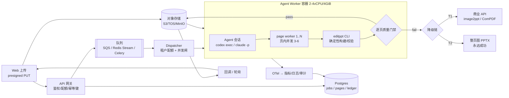

# F · 把「Agent + Skill」图片转可编辑 PPT 做成可上线、可计费的生产服务

> 调研日期：2026-10-20 ｜ 方法：官方文档原文 + GitHub API（repo/issue/raw）+ CLI 本机实测 + 二手实测报道
> 结论一句话：**技术上能无人值守跑通，但按现在的 Agent 形态，单页 ¥12–30、单页 10–60 分钟、整 deck 全通过率只有个位数百分比。它只能做「高价长尾」通道，不能做主力通道。**

---

## 0. TL;DR（给决策者的 8 行）

1. **能 headless 跑**：`codex exec` 与 `claude -p` 都不需要 TTY、不需要交互确认（前提是显式关掉审批），本机已实测跑通并拿到 JSON 用量。
2. **但"能跑"≠"能卖"**：Skill 的图片后端默认走 **Codex 内置 `image_gen.imagegen` / Codex OAuth**（订阅态）。订阅额度不能转售，生产必须切到 API Key + 自建图生模型通道。
3. **成本**：LLM $1.3–4.2/页 + 生图 $0.15–1.2/页 + 容器 $0.02–0.06/页 ≈ **$1.5–5.5/页（¥11–39）**。实测锚点：12 页烧 $50 GPT 额度、40M tokens。
4. **时延**：单页 p50 **12–20 min**、p90 **30–60 min**；12 页 deck（6 路页并发）**40–90 min**。商业 API 是 2–3 min/页、¥0.7–1.0/页。
5. **成本结构 97% 是 token**，而 token 里 90% 是**每轮重复读上下文**（实测：`codex exec` 一句 "OK" 就吃 79,187 input tokens；`claude -p` 冷启动写 46,773 tokens 缓存）。
6. **可靠性**：单页失败是**显式失败**（`validation.json passed:false` 就不许 record/finalize），不会静默交付坏文件；代价是**一页失败整 deck 卡死**，所以 deck 级门禁不可用，必须逐页门禁 + 逐页降级。
7. **最小生产架构**：上传→对象存储→任务表→队列→**一 job 一容器**的 Agent worker→产物回对象存储→逐页校验→回调。1 容器 1 job、页内 3–6 并发、45 min 硬超时、`--max-budget-usd` 兜底。
8. **分流**：数字原生页/纯文字表格走确定性管线（秒级、¥0.1–1），只有「OCR 覆盖率 <85% 或组件置信度 <0.9 或页价值 >¥30」的页才升级到 Agent。

---

## 1. Agent Skill 的技术契约（规范原文要点）

### 1.1 开放标准（Anthropic 主导，跨厂商）

来源：<https://agentskills.io/specification>（原文抓取，2026-10-20）

目录结构（唯一硬约束是 `SKILL.md`）：

```
skill-name/
├── SKILL.md          # 必需：YAML frontmatter + Markdown 指令
├── scripts/          # 可选：可执行代码
├── references/       # 可选：按需加载的文档
├── assets/           # 可选：模板/图片/数据
└── ...               # 任意附加文件
```

frontmatter 字段表（原文）：

| 字段 | 必需 | 约束 |
|---|---|---|
| `name` | 是 | ≤64 字符；仅 `a-z0-9-`；不能首尾连字符、不能连续 `--`；**必须与父目录同名** |
| `description` | 是 | ≤1024 字符，非空；说明"做什么 + 何时用" |
| `license` | 否 | 许可证名或指向 bundle 内文件 |
| `compatibility` | 否 | ≤500 字符；声明环境要求（产品、系统包、网络） |
| `metadata` | 否 | 任意 string→string 映射 |
| `allowed-tools` | 否 | 空格分隔的预授权工具列表（**Experimental**） |

**渐进式披露（progressive disclosure）三级预算**（原文数值，直接决定成本模型）：

- 元数据 ~100 tokens：所有 skill 的 `name`+`description` 在启动时全量加载
- 指令 <5000 tokens（建议）：skill 被激活时加载整个 `SKILL.md` 正文
- 资源 按需：`scripts/ references/ assets/` 只在需要时读

> 原文："Keep your main SKILL.md under 500 lines." / "Keep file references one level deep from SKILL.md."

校验工具：`skills-ref validate ./my-skill`。

### 1.2 Claude Code 的扩展（超集）

来源：<https://code.claude.com/docs/en/skills>

- Claude Code 明确"follows the Agent Skills open standard"，并**额外扩展**了：invocation control、subagent execution、dynamic context injection。
- 加载位置（决定了服务端怎么塞 skill）：enterprise `managed settings/.claude/skills/` ｜ personal `~/.claude/skills/` ｜ project `.claude/skills/` ｜ nested ｜ `--add-dir` 目录 ｜ plugin `<plugin>/skills/`。
- `name` 决定斜杠命令名；`.claude/commands/*.md` 是旧格式，仍兼容。
- 非标准字段（Claude Code 专有）：`disable-model-invocation`、`argument-hint`、`context: fork`、`agent:`、`model:` 等（文档 "Frontmatter reference" 有对照表）。
- **程序化调用**：文档明说"Claude uses skills when relevant, or you can invoke one directly with `/skill-name`"。

### 1.3 Codex Skills 的差异（重要，别混用）

来源：<https://developers.openai.com/codex/skills>

- 目录同样是 `SKILL.md` + `scripts/ references/ assets/`，另有可选 `agents/openai.yaml`。
- **frontmatter 只强制 `name` + `description`**（比开放标准宽松，`license/metadata` 不是必须）。
- **扫描路径不同**：`.agents/skills`（不是 `.claude/skills`）——`$CWD/.agents/skills`、`$CWD/../.agents/skills`、`$REPO_ROOT/.agents/skills`、`$HOME/.agents/skills`、`/etc/codex/skills`（**官方标注 "Use for SDK scripts, automation"** —— 这就是服务端预装 skill 的正规位置）、以及内置 system skills。
- **目录预算**：初始 skill 列表默认只占上下文 **2% 或 8,000 字符**（context window 未知时）；可用 `skills.max_context_tokens` 调到最多 10,000 tokens。skill 多时**优先截短 description**，过多则直接不列出并警告。
  → 生产含义：description 必须"前置关键词"，否则长尾 skill 会被静默隐藏，出现"有时不触发"的玄学 bug。
- 触发方式：**显式**（CLI 里 `/skills` 或输入 `$` 选；ChatGPT 里 `@`）、**隐式**（按 description 匹配）。
- `agents/openai.yaml` 可设 `policy.allow_implicit_invocation: false`（只允许显式调用）+ `dependencies.tools`（声明依赖的 MCP server）。
- 分发：单 repo 用目录，跨团队用 **plugin**（可捆绑多个 skill + MCP + 展示资源）。
- 禁用：`~/.codex/config.toml` 里 `[[skills.config]] path=... enabled=false`。

### 1.4 Skills CLI

```
npx skills add <owner/repo> --skill <name> --agent <id> --global   # 安装
npx skills use <package>@<skill>                                    # 不安装，直接生成调用提示
npx skills list / update / remove
```
（`npx -y skills@latest --help` 实测输出，支持 `--copy`、`skills-lock.json`、`experimental_sync`。）

---

## 2. 服务端非交互运行（核心）

### 2.1 硬结论表

| 运行时 | 无人值守 | 需要登录态 | 需要 TTY | 结构化输出 | 硬预算/超时 | 生产可用性 |
|---|---|---|---|---|---|---|
| `codex exec` | ✅ | ✅ 需 `codex login`（API key 或 ChatGPT） | ❌ | `--json`(JSONL) / `-o` 最后消息 / `--output-schema` | 外部 timeout；无内建预算 | ★★★★ |
| Codex SDK (`openai_codex` / `@cursor/sdk`) | ✅ | 同上 | ❌ | 对象 | `max_turns` | ★★★★ |
| `claude -p` | ✅ | ✅ `ANTHROPIC_API_KEY` 或 OAuth | ❌ | `--output-format json/stream-json` + `--json-schema` | **`--max-budget-usd`（硬停）** | ★★★★★ |
| Claude Agent SDK | ✅ | 同上 | ❌ | 消息对象 | `max_turns` + budget | ★★★★★ |
| OpenAI Agents SDK / LangGraph | ✅ | 需自己接 | ❌ | 自己定 | 自己实现 | 只是编排层，不含 skill 语义 |

### 2.2 本机实测（2026-10-20，真实跑通，不是"文档说可以"）

```bash
$ codex login status
Logged in using an API key - oc_sk_cf***aQVaE

$ codex exec -s read-only --skip-git-repo-check --json "Reply with exactly: OK"
{"type":"turn.started"}
{"type":"item.completed","item":{"type":"agent_message","text":"OK"}}
{"type":"turn.completed","usage":{"input_tokens":79187,"cached_input_tokens":12032,
 "cache_write_input_tokens":0,"output_tokens":2,"reasoning_output_tokens":0}}
```

三个可复用的结论：

1. **`codex exec` 完全无 TTY**，stdout 是纯 JSONL，`usage` 事件自带精确 token 计量 → **可以直接拿来做计费**。
2. **固定上下文税极高**：一句 "OK" 就 79,187 input tokens。这台机器上装了 ~80 个 skill + MCP（日志里 canva MCP 还在报 `Missing or invalid access token`）。生产必须 `--ignore-user-config` + 干净 `CODEX_HOME`，否则你为别人的 MCP 配置付费。
3. 用户级 `config.toml` 的无效字段会以 `item.completed/type=error` 混进事件流 → 解析器要能忽略。

```bash
$ claude -p "Reply with exactly: OK" --output-format json --max-budget-usd 0.05
..."modelUsage":{"claude-opus-5":{"inputTokens":4,"outputTokens":2,
 "cacheCreationInputTokens":46773,"costUSD":0.29240125,...}},
 "terminal_reason":"budget_exhausted","subtype":"error_max_budget_usd",
 "duration_ms":4719,"is_error":true
```

1. 默认模型是 **claude-opus-5**（最贵那档），一次 "OK" 花 **$0.29**，其中 46,773 tokens 是 **cache write（$5/Mtok）**。
2. `--max-budget-usd` 是**真正硬停**：`terminal_reason=budget_exhausted`，进程正常退出（exit 0，注意不是非零）。→ 生产用它做单 job 熔断，但**必须自己判 `is_error`**。
3. `costUSD` 是客户端估算（文档也这么说），账单以 API 侧为准。

### 2.3 生产命令片段

**Codex（一 job 一容器）**

```bash
export CODEX_HOME=/srv/tenants/$TENANT/.codex     # 隔离：不带用户 MCP/skill/AGENTS
mkdir -p "$CODEX_HOME"
codex exec \
  --skip-git-repo-check --ephemeral --ignore-user-config \
  -C /work/$JOB \
  -s workspace-write \
  -c approval_policy=never \
  --json -o /work/$JOB/final.md \
  "使用 image-to-editable-ppt 技能：把 /work/$JOB/input/*.png 转成可编辑 pptx，输出到 /work/$JOB/out/"
```

- `-s workspace-write` + `approval_policy=never`：文档原话 "use `on-request` for interactive runs or **`never` for non-interactive runs**"（<https://developers.openai.com/codex/config-reference>）。
- `--ephemeral`：不落 session 文件；`--add-dir` 可加可写目录。
- **没有内建 wall-clock 超时**，必须外层 `timeout`/k8s `activeDeadlineSeconds`。
- **`$skill` 显式点名是 TUI 的能力**（"run /skills or type $ to mention"）。在 `exec` 里更稳的做法是：把 `SKILL.md` 路径写进 prompt，或依赖 description 隐式命中（→ 用 `agents/openai.yaml` 的 `allow_implicit_invocation` 与 description 关键词控制）。这是**上线前必须用真实 prompt 回归**的点。

**Claude Code**

```bash
claude -p "/image-to-ppt 把 /work/$JOB/input/p1.png 转为可编辑 pptx，输出到 /work/$JOB/out" \
  --output-format stream-json --verbose \
  --permission-mode acceptEdits \
  --allowedTools "Read,Write,Edit,Bash(editppt *),Bash(python3 *),Bash(pipx *)" \
  --add-dir /work/$JOB \
  --max-budget-usd 3.0 \
  --setting-sources "" \
  --include-partial-messages
```

- **无 TTY 时权限默认是 Manual**：文档原文 "In a Manual mode `claude -p` run, a call that needs approval is denied unless something approves it"（v2.1.302+ 默认 Manual）。→ 必须 `--allowedTools` 或 `--permission-mode`，否则 skill 里的 `bash`/写文件**静默被拒**，表现为"skill 跑了一半啥也没产出"。
- **`--bare` 会跳过 skill 发现**（文档：skipping auto-discovery of hooks, **skills**, custom commands...）。所以**不能用 `--bare` 求快**，要用干净的 `CLAUDE_CONFIG_DIR`。
- 有 `--max-budget-usd`，**没有** `--max-turns`（CLI）；turn 上限在 SDK 的 `maxTurns`（超限时 result subtype = `error_max_turns`）。
- 结束/取消：`SIGTERM` → exit code **143**，当前 turn 记为未完成；要"正常收尾"应先 `SIGINT` 或 SDK `interrupt()`。

**SDK 形态（推荐，省掉 shell 拼串）**

```python
# pip install claude-agent-sdk
from claude_agent_sdk import query, ClaudeAgentOptions

async for msg in query(
    prompt=f"用 image-to-ppt 技能转换 /work/{job}/input",
    options=ClaudeAgentOptions(
        cwd=f"/work/{job}",
        setting_sources=[],            # 不读用户/项目 settings，防串租户
        max_turns=120,
        env={"CLAUDE_CONFIG_DIR": f"/cfg/{job}",
             "CLAUDE_CODE_DISABLE_AUTO_MEMORY": "1"},
    ),
):
    ...
```

```python
# pip install openai-codex
from openai_codex import Codex, Sandbox
codex = Codex()
thread = codex.thread_start(model="gpt-6.1-sol", sandbox=Sandbox.workspace_write)
result = thread.run("用 image-to-ppt 技能转换 input/")
```

**托管形态**：Anthropic **Managed Agents**（官方 hosting 文档原话："Anthropic hosts the agent loop... tool execution runs in an Anthropic-managed cloud sandbox or a self-hosted sandbox"），按 **$0.08 / session-hour** + 标准 token 价计费（<https://claude.com/pricing>）。这是"最省事的一条路"，但沙箱在境外，国内业务有数据出境问题。

### 2.4 各家在"服务端批量、无人值守"下的真实限制

| 限制 | Codex | Claude Code |
|---|---|---|
| 需要 TTY | 否 | 否 |
| 会话持久化 | `--ephemeral` 可关；默认写 `~/.codex/sessions` | 默认写 `~/.claude/projects/*.jsonl`，可 `SessionStore` 外置 |
| 审批 | `approval_policy=never`；否则**卡住等输入 = 挂死** | 无 host 自动 deny；`--permission-mode` / `--allowedTools` |
| 后台等待 | 无 | **离开后最多再等 10 min 空闲**（`CLAUDE_CODE_PRINT_BG_WAIT_CEILING_MS` 可调） |
| 订阅转售 | 禁止（ChatGPT 额度） | 禁止（Claude 订阅） |
| 图片生成 | 内置 `image_gen.imagegen` **仅 ChatGPT 登录态**可用 | 无内置，需自接 API |

> 最后一行是**这条产品化路线最大的暗礁**：ningzimu skill 的默认图片后端就是 `image_gen.imagegen` → Codex OAuth → OpenAI-compatible API 三级降级（SKILL.md "Image Backend Selection" 明文）。SaaS 必须把第一二级关掉，只留第三级，并且按 **gpt-image-2.5-sunburst** 的真实单价重算成本。

---

## 3. 成本实测与估算

### 3.1 一手实测锚点

| # | 来源 | 规模 | 墙钟 | 花费 | 折算 |
|---|---|---|---|---|---|
| A | ningzimu README L44 + FAQ（**已核实原文**） | 10 页 | — | "有可能消耗完你的 5 小时额度" | 官方自述"单页 10min 以上"、"Plus 用户谨慎" |
| B | [issue #8](https://github.com/ningzimu/image-to-editable-ppt-skill/issues/8) | 12 页 | ~1 h | **$50 额度 / 40M tokens（4M 输入，其余缓存）** | **$4.17/页**，3.33M tokens/页 |
| C | [LINUX DO 实测帖](https://linux.do/t/topic/2324953) | 1 张 png | **30 min，有的 1 h** | — | 35 页 × 40 min ≈ 23.3 h |
| D | [80aj 报道](https://www.80aj.com/2026/06/08/ai-ppt-challenges/) | 35 页 | >23 h | 中转 API 长上下文**频繁 502**，只能"开 35 个会话手动并行" | 单张 30–60 min |
| E | image2editable `benchmarks/release/BASELINE.json` | 14 页 | **10,634 s（2.95 h）** | 纯 CPU、**计划回放、不含 LLM** | 单图页 546–942 s（**9–16 min**），PDF 2 页 2,478 s |
| F | 本机实测（本文档 §2.2） | 1 轮对话 | 4.7 s | claude $0.29 / codex 79k tokens | 固定开销 ~47–79k tokens/session |

> E 是最容易被忽略的一条：**即使把 LLM 拿掉**，SAM2.1-large + GroundingDINO + LaMa + OCR 的确定性管线在 CPU 上就要 9–16 min/页。所以"慢"不是 Agent 的锅，是**视觉管线的锅**。想快必须上 GPU 或换轻模型（但 skill 明确拒绝替换 SAM2.1-large）。

### 3.2 单价（2026-10 官方定价页，原文抓取）

| 模型 | 输入 | 缓存读 | 缓存写 | 输出 |
|---|---|---|---|---|
| claude-opus-5.5 | $4 | $0.20 | $5 | $20 |
| claude-sonnet-5.5 | $2 | $0.10 | $2.50 | $10 |
| claude-haiku-5.5 | $0.10 | $0.01 | $0.125 | $0.50 |
| gpt-6.1-sol | $2 | $0.10 | $2.50 | $10 |
| gpt-5.6-sol | $4 | $0.40 | $5 | $20 |
| gpt-6-astra | $10 | $1 | $12.50 | $50 |
| gpt-image-2.5-sunburst (image) | $8 | $2 | — | **$30** |
| gpt-image-2 (image) | $4 | $1 | — | $15 |

（单位：USD / 1M tokens。来源：platform.openai.com/docs/pricing、claude.com/pricing。）

### 3.3 单页成本模型（可复算）

一页 ≈ 40–100 个 agent turn，每 turn 重读 ~40–60k 上下文 → **2.5–3.5M tokens/页**（与 B 的 3.33M/页 吻合）。

| 项 | 计算 | 低 | 高 |
|---|---|---|---|
| 新输入 | 0.3M × $2 | $0.60 | $1.20 |
| 缓存读 | 3.0M × $0.10 | $0.30 | $0.60 |
| 输出 | 60k × $10 | $0.60 | $1.20 |
| **LLM 小计** | | **$1.50** | **$3.00** |
| 生图（3–8 次） | $0.05–0.15/张 | $0.15 | $1.20 |
| 容器/CPU | 1 vCPU × 20 min | $0.02 | $0.06 |
| **合计** | | **$1.67** | **$4.26** |

→ **¥12–30/页**（按 7.1 汇率），与 B 的 $4.17/页 同量级。**注意：这还没算失败重试**。按 1.3× 重试系数，实际 **¥16–40/页**。

### 3.4 对比：商业 API 的天花板价

| 通道 | 单价 | 时延 | 备注 |
|---|---|---|---|
| image2ppt.com | ¥0.70–1.00/页 | ~2 min/页，90% <3 min | 有 SDK/异步/callback/按页计费 |
| PPTBot | ¥0.30（普通）/ ¥1.50–2.20（高精） | 十几秒–分钟 | 无公开 API |
| 度慧（阿里云市场） | ≈¥0.003/次 | 10 页 15 s | OCR 路线，质量低 |
| **Agent+Skill** | **¥12–40/页** | **12–60 min/页** | 质量上限高，长尾能力强 |

→ **Agent 路线贵 15–40×、慢 6–30×**。这不是"优化一下就能打平"的差距，是**结构性差距**（token 重读 + 视觉管线 CPU）。

### 3.5 吞吐换算

- 官方 hosting 指南给的起步规格：**1 vCPU / 1 GiB / 5 GiB disk per agent session**（"a reasonable starting point"）。但 CV 管线是 CPU 密集，实测建议 **2–4 vCPU/session**。
- 一页 20 min → 单 session ≈ **3 页/小时**。
- 16 vCPU / 32 GiB 一台机 → 4–6 并发 session → **12–18 页/小时/台**。
- 单页基础设施成本 ≈ $0.02–0.06，**占比 <3%**，所以**优化机器没用，必须优化 token**。

---

## 4. 可靠性：失败率、可复现性、坏文件

### 4.1 已知真实 bug（GitHub issue 原文）

| Issue | 现象 | 根因 | 状态 |
|---|---|---|---|
| [#43](https://github.com/ningzimu/image-to-editable-ppt-skill/issues/43) | PowerPoint 双击报"文件可能已损坏"，但 LibreOffice/WPS 能开 | `a:fillStyleLst` 只有 1 个 `solidFill`，OOXML 要求**恰好 3 个** | **v0.3.3 修复**；v0.4.0 已含；旧文件不会自动修 |
| [#14](https://github.com/ningzimu/image-to-editable-ppt-skill/issues/14) | 需要"修复"才能打开，修复后版式错位；小图标被识别成像素点 | 包结构/XML/资源引用不合法 | 需样本定位；多名用户复现 |
| [#16](https://github.com/ningzimu/image-to-editable-ppt-skill/issues/16) | 转换效果极差 | "生图模型没有生效"（作者原话） | 后端配置问题 |
| [#11](https://github.com/ningzimu/image-to-editable-ppt-skill/issues/11) / [#10](https://github.com/ningzimu/image-to-editable-ppt-skill/issues/10) | token 花完了 PPT 没出来 | **环境审批器拒绝上传页面图到外部图片后端/OCR** | 交互态可"完全访问模式"绕过；**服务端无审批器，反而没这个问题** |
| [#10](https://github.com/ningzimu/image-to-editable-ppt-skill/issues/10) 评论 | `任务提交队列已满` | PaddleOCR 免费通道限流 | 自动降级到内置离线检测（**字号还原变差**） |
| [#35](https://github.com/ningzimu/image-to-editable-ppt-skill/issues/35) | 页内 image_gen 串行 → 单页极慢 | 设计如此 | 作者以"稳定性"为由关闭 |

### 4.2 设计上的可靠性（这是它比"脚本"强的地方）

- **确定性门禁**：每页产出 `manifest.json` + `validation.json`，`editppt run record` **校验 page.pptx 与 manifest 一致**，`validation.json` 顶层不是 `passed: true` 就**拒绝 record**；`finalize` 只从 record 过的页重建，并做 deck 级检查（zip 有效、页数匹配、媒体关系完整、hash 一致、**禁止"整页底图 + 文字浮层"冒充可编辑**）。
- **可恢复状态机**：`pending → dispatched(lease) → recorded → accepted/complete`，`editppt run reset` 把失败页打回 pending 重派（`--confirm-lost` 防止顶掉活着的 worker）。
- **失败契约**：worker 失败必须返回 `passed:false` + 具体原因；下一轮 worker **不信任**上一轮残留产物。
- **修复预算**：单组件最多 5 批修复计划，无改善即停（防无限烧钱）。

### 4.3 可复现性：**两次结果一定不同**

- LLM 决策 + 图像生成都无 seed 固定；`manifest.json` 的组件切分、资产来源、文字框位置会变。
- 反证：image2editable 的 release gate 要求 **3 次重复的 `request/graph hash` 完全一致**才出 official 报告，且 hash 不匹配时要"diagnostic"重跑 → **说明确定性只存在于"回放已记录的计划"**，不存在于"重新让模型想一遍"。
- 工程结论：**幂等不能靠"重跑一致"，只能靠"输入 hash 命中缓存就复用产物"**。

### 4.4 失败率（无公开数字，给可辩护的估算）

- 仓库侧：3015★ / 155 fork，但真实用户 bug issue 只有 ~10 条 → 报障率低，**不能反推成功率**。
- 从设计推：单页首次通过率（干净 PPT 截图）估 **70–85%**；复杂页（渐变/密集图标/艺术字/流程图）估 **40–60%**。
- **deck 级全通过率 = 0.8^12 ≈ 7%**。这就是"token 烧完 PPT 没出来"的真正原因。
- → **产品必须按页交付**：坏页降级为「整页高清图」或「商业 API 重跑」，deck 永远能出。

---

## 5. 最小可用生产架构



### 5.1 关键参数（可直接抄）

| 维度 | 取值 | 依据 |
|---|---|---|
| 1 容器 = 1 job | 是 | Agent 是有状态长进程，混跑会串文件 |
| 容器规格 | 4 vCPU / 8 GiB / 20 GiB 盘 | 官方 1vCPU/1GiB 是"下限"，CV 管线更吃 CPU |
| 页内并发 | 3–6（默认 6） | skill `page_jobs.json.max_concurrent_pages` 默认 6 |
| job 硬超时 | 45 min（单页 25 min） | 单页 p90 30–60 min，超时即降级 |
| 取消 | 先 SIGINT（正常收尾）→ 60 s 后 SIGTERM（exit 143） | Claude 文档明确 143 语义 |
| 预算熔断 | `--max-budget-usd`（Claude）/ 自建 token 计数（Codex） | 实测硬停有效 |
| 重试 | 同页最多 1 次，且**必须换条件**（换模型/关 OCR/降分辨率） | skill 自己的规则："不要在相同条件下重复" |
| 缓存 | 输入 sha256 + skill 版本 + 模型配置 → 产物 | 抵消非确定性 |

### 5.2 超时与取消（Agent 会跑 10 分钟，必须设计）

- **三层超时**：job 级（45 min）→ page 级（25 min）→ tool 级（`editppt image --timeout`）。
- **心跳**：worker 每 15 s 写 `heartbeat_at`；调度器只对"心跳停 + lease 过期"的 job 重派（fencing token 防双跑）。
- **取消语义**：用户取消 → 写 `cancel_requested` → 向容器发 SIGINT → 等 60 s → SIGTERM → 标记 `cancelled`，**产物保留但计费按已消耗页**。
- **不要用 SIGKILL 收尾**：Claude 未完成 turn 不记录，Codex 可能留下半截 pptx；两者都会让"审计"对不上。

### 5.3 幂等与去重

- 提交：`Idempotency-Key` header + `sha256(file)` 双键，24 h 窗口；命中直接返回既有 job_id。
- 页级：`page_key = sha256(page_png) + skill_version + backend`；命中复用 `page.pptx`（这是把 12 页 deck 的重跑成本从 12 页降到 1 页的关键）。
- 产物：内容寻址存储（`sha256/…pptx`），DB 只存引用。

### 5.4 多租户隔离（照抄官方 hosting 指南 + 自己加）

```
/work/<tenant>/<job>/          每 job 独立 cwd，tmpfs，任务结束即销毁
/cfg/<tenant>/<job>/           CLAUDE_CONFIG_DIR（防 ~/.claude.json 串号）
setting_sources = []           不读用户/项目 settings
CLAUDE_CODE_DISABLE_AUTO_MEMORY=1
CODEX_HOME=/srv/tenants/<t>/.codex  + --ignore-user-config
```
外加：非 root、只读 rootfs、seccomp、无 docker socket、**egress allowlist**（只放 `api.openai.com` / `api.anthropic.com` / `aip.baidubce.com` / 图床）、按租户独立出口 IP、审计每次外发的图片数量与大小。

> 合规红线：这个 skill 会把**用户页面图上传到第三方**（PaddleOCR、图片模型）。必须在 UI 上显式告知并留开关（skill 自己也有 `local-only` 分支），否则 B 端客户过不了安全评审。

### 5.5 计费

| 模式 | 适用 | 做法 |
|---|---|---|
| **按页预付点数**（推荐） | C 端/中小 B | 1 页 = 1 credit；提交时**冻结**，成功**结算**，失败页**退回**（对齐 image2ppt 的做法，用户已教育过） |
| 按 token 后付 | 大 B / 白标 | 用 provider 的 usage 事件（实测 Codex `turn.completed.usage`、Claude `modelUsage.costUSD`）做对账 |
| 按次（deck） | 简单场景 | 12 页以内一口价，风险由你担（**不建议**，方差太大） |

账本三件套：`reserve → settle → refund`，每页一行 `page_results`（页号、耗时、token、模型、后端、成败原因）——既是账单也是质量数据。

### 5.6 灰度与降级

```
Tier 0  确定性管线（OCR + OOXML 直出）      5–30 s      ¥0.1–1/页    覆盖 60–70% 页面
Tier 1  本地 CV 重建（SAM2+DINO+LaMa，无 LLM） 2–10 min   ¥0.5–2/页    覆盖 20–30%
Tier 2  Agent + Skill（本文主角）            12–40 min   ¥12–40/页    覆盖 5–15%
Tier 3  商业 API / 整页图                     2–3 min     ¥0.7–3/页    兜底，永远成功
```

- 灰度：**skill 版本 pin 到 commit sha**（`SKILL.md` 的 sha 进 job 记录），5% 流量跑新版本，按"逐页通过率 + 单页成本 + p90 时延"三指标自动回滚。
- 降级触发：页超时 / `validation.json passed:false` / 预算超限 / 连续 2 次同因失败 → 直接落 Tier 3，**不要重试第三次**。
- 观测：OTel（官方支持 `CLAUDE_CODE_ENABLE_TELEMETRY=1` + OTLP），至少埋：每页 token、每页墙钟、每页失败码、图生调用次数、外发字节数。

---

## 6. 关键判断：什么该用 Agent，什么不该用

### 6.1 一句话

> **Agent 买的是"长尾覆盖率"，不是"单位成本"。任何能用规则描述的页面，用 Agent 都是纯亏损。**

### 6.2 分流判据（可落到代码里的信号）

| 信号 | 阈值 | 动作 |
|---|---|---|
| OCR 文本覆盖率（可编辑文字面积 / 总文字面积） | ≥85% | 走 Tier 0/1，不上 Agent |
| 组件分类置信度（manifest `confidence`） | ≥0.90 且无 `retry_with_points` | 不上 Agent |
| 未知组件数 | ≤3 | 不上 Agent |
| 页面含渐变/阴影/发光/艺术字/手绘 | 任一命中 | 倾向 Tier 2 |
| 表格/图表/流程图检测命中 | 命中且需原生对象 | Tier 1（结构化重建）优先 |
| 单页业务价值 | <¥30 | 禁止 Tier 2（人力重做也就 15 min） |
| 日处理量 | >1000 页 | 禁止 Tier 2（机器装不下） |

### 6.3 什么时候**值得**上 Agent

1. **一次性高价值 deck**：融资/评审/投标材料，一页值几百块，慢 30 min 完全可接受。
2. **长尾版式**：AI 生成的海报式 PPT、设计稿、科研图、手绘，规则引擎必然崩。
3. **需要"判断"的页面**：这张图里哪个是图标、哪个是装饰、文字要不要拆行——这是 VLM 的主场，不是 OCR 的。
4. **自我修复有价值**：第一版坏了，Agent 会看 preview 自己改（这是它比 pipeline 强的**唯一**硬优势）。
5. **小批量、可排队**：夜间批处理，用户第二天取件。

### 6.4 什么时候**绝对别**用 Agent

1. 数字原生的 PDF/PPTX（有文字层）——直接解析，0 成本。
2. 纯文字/表格的规整页面——OCR + OOXML 几十行代码，5 s 出结果。
3. 大批量后台转换（>1000 页/天）——成本会击穿商业模型。
4. 要求"秒级/分钟级"的交互场景——物理上做不到。
5. 要求"同样输入同样输出"的合规场景——Agent 天生不保证。
6. 有数据出境限制的客户——skill 会把图传到第三方 OCR/图生。

### 6.5 产品形态建议

- **不要**把"Agent 转 PPT"当主卖点 → 会被 ¥1/页 的 image2ppt 打成筛子。
- **要**把它当 **"疑难页救援通道"**：主打"别的工具转不动的页面，我们能转"，按页 ¥9.9–19.9 定价，明确写"5–30 分钟"。
- 或者做成 **"人机协同编辑器"**：Agent 出初稿 + 逐页 diff 预览 + 用户点"重做这页"，把不可控变成可交互（同时把重试成本转嫁给"用户主动要求"）。

---

## 7. 现成的「Skill as a Service」基础设施

### 7.1 官方托管（最省事）

| 平台 | 能力 | 价格 | 限制 |
|---|---|---|---|
| **Anthropic Managed Agents** | 托管 agent loop；工具在 Anthropic 云沙箱或**自建沙箱**执行；SDK/REST 收发事件 | 标准 token 价 + **$0.08/session-hour** | 境外；文档需海外网络 |
| **Claude Agent SDK** | 自带 `claude` 二进制，自己部署；支持 SessionStore/hooks/权限/子 agent | 只付 token | 要自己写容器化与隔离 |
| **OpenAI Codex SDK / app-server** | TS `@cursor/sdk`、Python `openai_codex`；`codex app-server` 可做自定义客户端（鉴权/历史/审批/流式事件） | 只付 token | app-server 仍标 experimental |

### 7.2 开源胶水

| 项目 | 作用 | 备注 |
|---|---|---|
| [R3n3r0/agent-bridge](https://github.com/R3n3r0/agent-bridge) | 把 `claude -p` / `codex exec` / `kimi acp` 包成 **OpenAI 兼容 HTTP API**（`/v1/chat/completions`，含流式、工具调用、图片输入、会话） | Go 单二进制 + Docker；GPL-3.0；**正好是"skill → HTTP"的现成壳** |
| [skills.sh / `npx skills`](https://skills.sh) | skill 包管理 + `use` 免安装生成 prompt | 适合做"无状态调用" |
| [SkillsMP](https://skillsmp.com) | skill 市场/索引（含 image2editable、MiMo 等） | 分发渠道 |
| [InferX Skill Function](https://inferx.net/skill-function-whitepaper/) | "Skill-as-a-Service"概念白皮书：每个 skill 一个独立上下文 + 作者绑定模型 + **零工具权限**（只出文本） | 厂商白皮书，ROI 数字（降本 70–90%）**无第三方验证**，当思路看 |

### 7.3 国内

| 平台 | 能力 | 判断 |
|---|---|---|
| **火山 ARK Managed Agents**（`arkcli agent`） | Agent / **Skill（zip 上传 + 版本管理 + SkillHub）** / Environment（setup script）/ Session（可挂 TOS 目录）/ Files / Memory Store / Vault / MCP OAuth；事件游标流式 | **国内最接近"skill 托管"的成品**：上传 skill zip → 建 agent → 开会话 → 挂 TOS → SSE 收结果。做国内版首选 |
| **百度搭子（Dumate）** | 融合 Skills + MCP + 工作流 + 知识库，托管运行环境 | 文档少，需实测 |
| **Coze / Dify / n8n** | 工作流编排 | **不是 skill 运行时**，只能当外层编排 |

---

## 8. 上线检查清单（Go / No-Go）

**必须解决（否则不要上线）**
- [ ] 关掉 Codex 内置 `image_gen` 与 OAuth 路径，只走自有 API Key（否则违反订阅条款）
- [ ] 干净 `CODEX_HOME` / `CLAUDE_CONFIG_DIR`，`--ignore-user-config` / `setting_sources=[]`（否则 79k tokens 的固定税）
- [ ] 每页 `validation.json` 门禁 + 逐页降级链（否则整 deck 卡死）
- [ ] job/page/tool 三层超时 + `--max-budget-usd` 熔断
- [ ] 输入 hash 缓存（否则重试成本翻倍）
- [ ] 数据出境告知 + 开关 + 审计

**应该做**
- [ ] 把"页"做成计费与重试的最小单位（不是 deck）
- [ ] 每页记录 `page_results`（成本/时延/失败码）作为定价依据
- [ ] 灰度按 skill commit sha pin，A/B 看逐页通过率
- [ ] GPU 化视觉管线（BASELINE 显示 CPU 上单页 9–16 min，这是最大时延来源）

**可以先不做**
- [ ] 自研 skill 运行时（先用 `codex exec` / `claude -p`）
- [ ] 多模型路由（先把单模型跑稳）
- [ ] 实时预览（先做"完成后逐页 diff 预览"）

---

## 9. 来源

**规范/文档（原文抓取）**
- Agent Skills 规范：<https://agentskills.io/specification>
- Claude Code Skills：<https://code.claude.com/docs/en/skills>
- Claude Code Headless：<https://code.claude.com/docs/en/headless>
- Claude Agent SDK 概览：<https://code.claude.com/docs/en/agent-sdk/overview>
- Agent SDK Hosting（并发/隔离/成本）：<https://code.claude.com/docs/en/agent-sdk/hosting>
- Managed Agents：<https://platform.claude.com/docs/en/managed-agents/overview>
- Codex Skills：<https://developers.openai.com/codex/skills>
- Codex SDK：<https://developers.openai.com/codex/sdk>
- Codex 配置参考（approval/sandbox/skills 预算）：<https://developers.openai.com/codex/config-reference>
- 定价：<https://platform.openai.com/docs/pricing> ｜ <https://claude.com/pricing>

**仓库/数据**
- ningzimu/image-to-editable-ppt-skill（3015★，MIT）：README L44、docs/faq.md、skills/.../SKILL.md、references/cli-helper.md、CHANGELOG.md、issue #8/#10/#11/#14/#16/#35/#43
- DSY-Xueai/image2editable（56★，MIT）：README、skills/image-to-ppt/SKILL.md、benchmarks/release/BASELINE.json、plans/*.json
- CodingFeng101/slide-alchemy（45★，MIT）：README（"Token and timing benchmarks will be added after measurement" —— **作者自己没测**；示例 run 里单页 6 张素材表 → 约 7 次图生调用）
- R3n3r0/agent-bridge、InferX Skill Function whitepaper、skillsmp.com

**实测报道**
- <https://linux.do/t/topic/2324953>（1 张 png 30 min；12 页 $50/40M tokens/1 h）
- <https://www.80aj.com/2026/06/08/ai-ppt-challenges/>（35 页 >23 h，502 中断，35 会话手动并行）

**本机实测（2026-10-20）**：`codex exec --json` 与 `claude -p --output-format json` 各一次 smoke test，数据见 §2.2。

---

*文档内所有"¥"按 1 USD = 7.1 CNY 折算；所有价格为 2026-10 公开页价，未含折扣与批量协议。*
