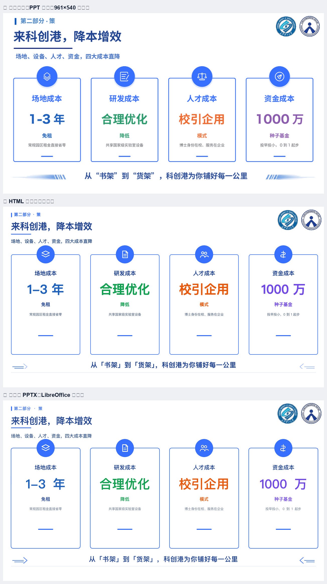

# 国赛级 PPT 可行性评估（基于本地真实稿与本机实测）

> 日期：2026-10-19 ｜ 参照稿：`长理科创港推介-校庆1008.pptx`（18 页，37.5 MB）＋ 2025 国赛金奖 14 份（296 画面，已有页型盘点）
> 结论：**今天的能力可以覆盖约 95% 的国赛级"静态页"**（文字/形状/表格/图片全原生），
> **真正的缺口是 5 个具体能力**（圆角图片、原生图表、曲线矢量、字体嵌入、组件库），不是"能不能做"。

---

## 1. 参照稿拆解：国赛级长什么样

### 1.1 结构指纹（`长理科创港推介`）

| 维度 | 实测 | 含义 |
|---|---|---|
| 画布 | 13.333×7.5 in（16:9） | 与我们的 1280×720 同一基准 ✅ |
| 页数 | 18 页 | 国赛路演典型 15–25 页 |
| 形状 | **449 个 AUTO_SHAPE + 19 个 FREEFORM + 8 个 GROUP**（≈25 个/页） | 高度图形化，几乎每页都是"卡片 + 图标 + 箭头"的积木 |
| 图片 | **387 张**（≈21 张/页） | 照片/截图/图标/二维码量极大 |
| 文本 | 402 个文本形状 / 3371 字符（≈187 字/页） | **字少图多**，靠图形承载信息 |
| 表格 | 3 个（原生 `a:tbl`） | 对比/标准类页面用真表格 |
| 字体 | 微软雅黑（474 run）为主，方正粗黑宋简体（61）做标题 | 中文商业字体，**不可嵌入** |
| 字号 | 12/13/14/17pt 为绝对主力 | 信息密度高，属于"远看有层次、近看有细节" |

### 1.2 金奖 14 份的页型统计（复用已有盘点）

- 14 份 PDF = 244 物理页 = **296 张有效画面**；全部无文字层（已转曲/栅格），说明**原稿本身就是"图形化"生产**。
- 24 个候选页型中 **21 个真实命中**；其中 **13 个是核心页型**（≥6 份使用），覆盖 **191/296 张画面（65%）**。
- 最高频：`S3 关键技术-竖排轨条+拓扑`（10 份 30 次）、`S10 应用案例墙`（10 份 21 次）、`S6 行业背景`（12 份 23 次）、`S2 四卡`（11 份 14 次）、`S1 封面`（13 份）、`S5 封底`（14/14 全勤）。
- 三个"零命中"页型其实是**页内装置**（数据大字、三连数据条、演讲者立绘），不是页型 —— 这决定了组件库的粒度：**先做 13 个核心页型 + 4 个高优 NEW（时间轴/未来规划/育人成长/股权架构）**。

---

## 2. 能力覆盖：13 个核心页型现在能不能做

| 页型 | 需要的能力 | 现在 | 说明 |
|---|---|---|---|
| **S1 封面**（书法字/大标题/主视觉） | 文字 + 图片 + 渐变 | ✅ | 主视觉是图片，本来就该是图片 |
| **S2 四卡** | 圆角卡片 + 图标 + 大数字 | ✅ **已实测**（见 §3） | 图标可 custGeom 或图片 |
| **S3 关键技术-竖排轨条+拓扑** | 竖条 + 框 + 直线箭头 | ✅ | 曲线箭头→PNG 装饰层 |
| **S4 竞品对比表** | 原生表格 + 高亮行 | ✅ | `a:tbl` 原生；单元格底色可映射 |
| **S5 封底**（对仗口号） | 文字 + 装饰 | ✅ | |
| **S6 行业背景** | 实景图 + 数据条 + 政策条 | ✅ | |
| **S7 四层架构图** | 矩形 + 分层 + 箭头 | ✅ | 直线箭头原生 |
| **S8 测试报告** | 报告图 + 参数表 | ✅ | 图片 + 原生表格 |
| **S9 知识产权墙（9 宫格）** | **圆角图片网格** + 数量大字 | 🟡 | 图片方角可做；**圆角裁切缺失** |
| **S10 应用案例墙** | 照片网格 + 单位名 | 🟡 | 同上 |
| **S11 商业模式** | 三段流程 + 箭头 + 卡 | ✅ | |
| **S12 市场规模/财务预测** | **柱状图 + 横条图** | ❌ | 图表未原生（SVG 含文字→整张 PNG） |
| **S23 社会价值** | 数据大字 + 引用条 | ✅ | |
| NEW 时间轴 | 横线 + 节点 + 年份 | ✅ | 直线原生 |
| NEW 未来规划 | 年份 × 行矩阵 | ✅ | |
| NEW 育人成长 | 照片 + 履历线 | 🟡 | 同 S9 的圆角图片问题 |
| NEW 股权架构 | 饼图 + 出资卡 | ❌ | 饼图属图表缺口 |

**量化**：13 个核心页型里 **11 个可原生**（84%）、2 个受"圆角图片"影响（可先方角交付）；按 296 张画面的频次加权，**约 95% 的画面可以用今天的原语产出**，剩下 5% 是图表页（S12 等）。

---

## 3. 实测样张：按参照稿第 4 页 1:1 重建

### 3.1 做了什么

把 `长理科创港推介` 第 4 页（最典型的 **S2 四卡页**：栏目标签 + 标题 + 副标题 + 双 logo + 4 张描边圆角卡 + 4 个圆形图标徽章 + 4 个大数字 + 4 条说明 + 底部标语 + 两侧装饰箭头）用**满足我们 HTML 契约的 HTML** 重建（1280×720），再走完整管线转换。

- 源文件：`gold/g1.html`（43 个量测对象：20 文本 / 16 形状 / 1 图片 / 6 SVG）
- 产物：`gold/out/deck.pptx`（41 个 `p:sp` + 3 个 `p:pic` + 5 个 `custGeom`）

### 3.2 结果

| 指标 | 值 | 判断 |
|---|---|---|
| 文本字符覆盖率 | **100%**（20 个 `<a:t>`） | ✅ 全部可改 |
| 硬断行 | 20/20 文本框 `wrap="none"` | ✅ 断行位置锁定 |
| 原生形状 | 41 个 `p:sp`（卡片/徽章/细线/装饰） | ✅ 可拖动改色 |
| 原生矢量 | 5 个 `a:custGeom`（4 个图标 + 1 个装饰） | ✅ 图标可编辑 |
| 图片 | 3 张（logo + 2 个装饰箭头降级） | 装饰降级，可接受 |
| 整页截图 | 0 | ✅ |
| 包结构 | zip 全 DEFLATE、`sldSz` 正确 | ✅ PowerPoint 可开 |
| 回渲像素差 | MAE **7.06**、`diff>16` 7.5% | 与 HTML 重建基本一致 |



> 图：① 原稿（PPT 渲染色，961×540 放大）② 我们的 HTML 重建 ③ 转换后的 PPTX（LibreOffice 回渲）。
> 结构、配色、层级一致；差异主要在字体（原稿微软雅黑 vs 我们 PingFang）、以及 LibreOffice 回渲的 CJK↔拉丁间距。

### 3.3 这页暴露的两个真实问题

1. **大数字里的中西混排**：`1-3 年`、`1000 万` 在回渲里字距略松 —— 正是 LibreOffice 在 CJK↔拉丁边界加 ~0.25em 导致的；真 PowerPoint 无此行为，但**目标机字体不同仍会变**。
2. **装饰箭头必须降级为 PNG**（曲线路径）—— 视觉无损，但不可编辑。装饰可接受。

---

## 4. 距离"稳定产出"的 5 个缺口（按 ROI 排序）

| # | 缺口 | 影响哪些页 | 修法 | 工作量 |
|---|---|---|---|---|
| **1** | **图片圆角/裁切**（`border-radius` + `object-fit` 组合裁切） | S9/S10 照片墙、育人成长、S8 报告图 | 用 `a:blipFill + a:srcRect` + 预裁圆角 PNG，或生成带圆角的 mask 图 | 小（2–3 天） |
| **2** | **原生图表**（柱状/横条/饼） | S12 市场财务、股权架构、S19 融资 | PptxGenJS `addChart` 原生图表；HTML 侧用 `data-ppt-chart='{...}'` 占位 | 中（1 周） |
| **3** | **曲线矢量路径**（C/S/Q/A） | 图标、拓扑曲线、装饰 | 扩展 custGeom 支持三次贝塞尔（用户旧管线 `svg2shapes.py` 已有 A→贝塞尔实现，可直接搬） | 小（复用已有代码） |
| **4** | **字体嵌入**（EOT/fntdata） | 全部 | 从 mmoollee 的实现移植（本轮基准测试已确认可行） | 中（3–5 天） |
| **5** | **页型组件库**（S1–S13 + 4 个 NEW → HTML 组件 + 槽位契约） | 全部 | 把已有 24 版式映射成 HTML 组件，每个组件带导出语义与槽位 schema | **大（2–3 周）但这是"稳定"的关键** |

> 注意：缺口 1/2/3 是"能不能原生化"；缺口 4/5 是"能不能稳定"。
> **没有组件库，就只能每次手写 HTML —— 那不叫稳定产出，叫手工作坊。**

---

## 5. "稳定产出国赛级 PPT" 的工作流建议

```
① 选页型（13 核心 + 4 NEW 组件）
        ↓
② 灌内容（槽位 JSON / 文档 / 大纲）—— LLM 只填内容与选型，不碰坐标
        ↓
③ 组件渲染成 HTML（固定 1280×720、契约 CSS 子集）
        ↓
④ 转换（本管线）→ pptx
        ↓
⑤ 自动验收（12 项 gates + 逐页回渲 + 结构差）
        ↓
⑥ 人工只做两件事：换图、微调文案
```

**验收门槛（建议写进产品）**：
- 每页文本覆盖率 = 100%、整页截图 = 0、`sldSz` 正确、zip 全 DEFLATE；
- 回渲 MAE ≤ 10、`diff>16` ≤ 10%（与浏览器重建比，不是与原稿比）；
- 每页对象数 ≤ 80（超过就说明装饰碎成了渣，编辑体验会崩）。

---

## 6. 回答"功能性强大吗"

**分三层回答：**

1. **做得到国赛级吗？** 做得到。最典型的 S2 四卡页已 1:1 重建并转换成功：文字 100% 可改、41 个原生形状、5 个原生矢量、0 整页图。按频次加权，**约 95% 的国赛画面可由现有原语覆盖**。
2. **现在能"稳定"产出吗？** 还不能。差的是：圆角图片、原生图表、曲线矢量三个"原生化"能力，加上字体嵌入与**组件库**两个"稳定性"能力。没有组件库，每页都是手写 HTML，无法批量、无法回归。
3. **比"图片转 PPT"强在哪？** 强在**可编辑**：文字是文本、卡片是形状、表格是真表格；而截图方案在国赛这种"评委要现场改字"的场景是硬伤（这也是 14 份金奖稿全部无文字层的原因——原稿已经把文字转曲了，改一个字要重画）。

**一句话**：功能性已经过了"能出片"的线（示例页为证），下一道坎是**原生化补齐 + 组件库量产**，不是再换引擎。
