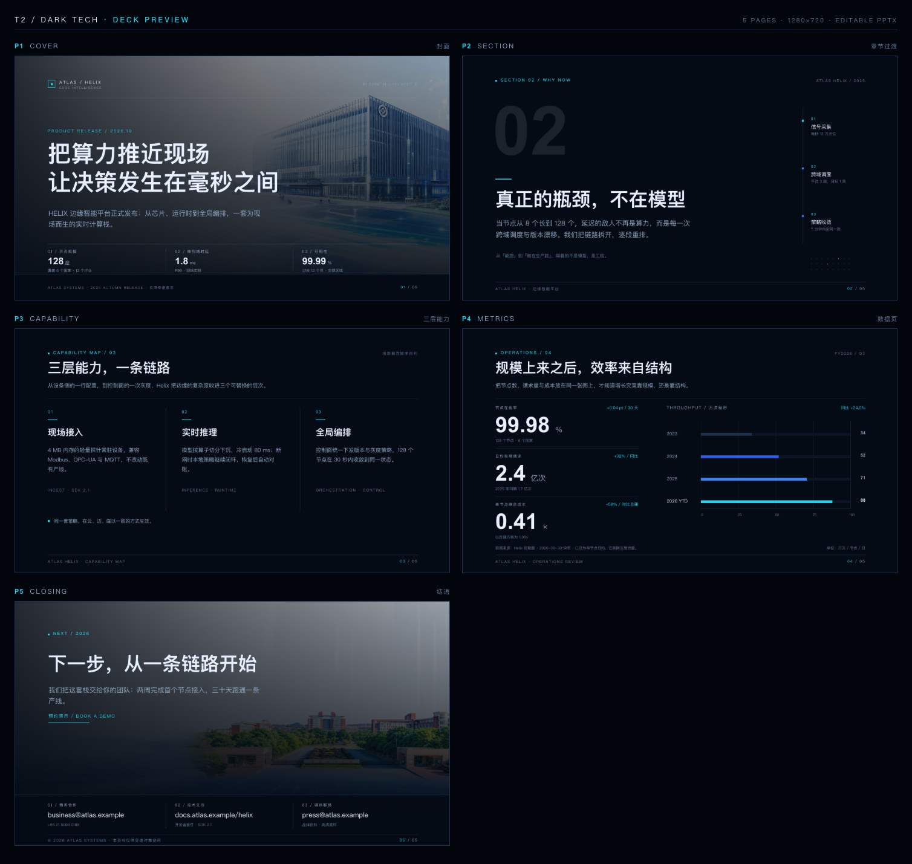

# T2 · Dark Tech — 深色科技 5 页模板

> 近黑底、青色刀口、大图压暗。为路演与技术发布准备的一组 1280×720 页面：冷静、精密、有信息密度。
> 所有文字保持原生文本，所有可替换内容带 `data-slot`，导出后仍可逐字编辑。



---

## 1. 审美说明

**不是把白底反相，而是先定三层黑。**
背景 `#050B14` 压到近黑，面板 `#0B1524` 只比背景亮一档，细线 `#1B3350` 负责分区。三阶文字 `#E8F1FF` → `#8FA6C2` → `#5E7795`，层级靠明度而不是字号堆叠。大面积永远留给照片或留白，不发明白色卡片。

**青色只做刀口。**
`#22D3EE` 每页只出现 3–5 处：eyebrow 前的小方块、栏头短线、KPI 变化值、当前页码。`#3B82F6` 退到图表中间年份与第二根 rail 节点，负责“过程”，不负责“结论”。一页里两种彩色同时出现时，青色永远更靠前。

**网格是硬的，呼吸是软的。**
左右边距 96 / 1184（内容 1088）；标题 40px 起于 88，导语 16px 起于 152，204 处一条通栏细线，664 处页脚线。三列页列宽 300，列起点 96 / 490 / 884，竖线落在 443 / 837。所有坐标整数，所有字号/行高 px 写死。

**字号与数字。**
封面 68/84，章节与结语 56/68，内页标题 40/52，栏标题 26/36；正文 16/28，导语 20/32。微型标签 11–12px、字距 2–3px、拉丁全大写。数字一律 `Arial 700`，与中文的 `PingFang SC` 形成“工程感 vs 叙述感”的对照；页码用青色标当前页，`01 / 05` 的字距 2px。

**图片是材质，不是插图。**
封面 `cover-building.jpg` 占 1280×640，结语 `campus.png` 占 1280×568——都停在画布 90% 面积以下，保证 `noFullPagePicture` 门禁通过。图片上压两层独立渐变（不是 `filter`、不是 `mix-blend-mode`）：一层是规定的 `rgba(5,11,20,.35) → .92` 纵向压暗，另一层从左到右的 78%→0 让标题区更静。两层都会在 PPTX 里变成原生 `gradFill` 形状，保持可编辑。

**装饰只做三件事：编号、细线、点阵。**
没有圆角卡片（全局 radius = 0），没有阴影，没有描边按钮。6px 小方块做节点，28–120px 短线做重音，章节页右下 24 个 2px 点构成一块很轻的点阵。留白是主动的：三列页正文止于 432，摘要句落在 552，中间 120px 故意空着。

**五页节奏。**
P1 压暗大图 + 68px 两行标题 + 底部三指标；P2 200px 半透明白 `02` 做水面下的锚，标题和导语浮在上层；P3 三栏能力，栏间 1px 竖线，编号与青色短线同高；P4 左侧三组 64px KPI、右侧 4 条水平条形图，底部数据来源；P5 校园全景 + 一行大字 + 三列联系方式，联系方式落在实体深色带上，不再和照片抢读。

### 设计 token

| 用途 | 值 |
|---|---|
| 背景 | `#050B14` |
| 面板 / 条形底槽 | `#0B1524` |
| 细线 | `#1B3350`（照片上改用 `rgba(232,241,255,.14–.20)`） |
| 主文字 | `#E8F1FF` |
| 次文字 | `#8FA6C2` |
| 三级文字 | `#5E7795` |
| 强调 | `#22D3EE` |
| 辅助 | `#3B82F6` |
| 中文字体 | `PingFang SC` |
| 数字字体 | `Arial` 700 |

---

## 2. 五页槽位表

共 **106 个槽位**，命名规则 `页.位置`，同一页内不重复。`cover.metric1..3`、`section.rail1..3`、`ability.col1..3`、`data.kpi1..3`、`closing.contact1..3` 均为按序号展开的三组。

| 页 | 版式 | 槽位（前缀 + 数量） | 关键槽位 |
|---|---|---|---|
| P1 | 封面：全幅压暗大楼图 + 微标 + 68px 标题 + 底部数据条 | `cover.*` × 17 | `cover.title`、`cover.subtitle`、`cover.metric1..3.{label,value,note}`、`cover.page` |
| P2 | 章节过渡：200px `02` + 标题 + 导语 + 右侧细线 rail | `section.*` × 17 | `section.number`、`section.title`、`section.lead`、`section.rail1..3.{no,title,note}` |
| P3 | 三列能力：编号 + 青色短线 + 标题 + 3 行说明，1px 竖线分隔 | `ability.*` × 19 | `ability.col1..3.{no,title,body,meta}`、`ability.note` |
| P4 | 数据：3 组 64px KPI + 4 条水平条形图 + 来源 | `data.*` × 38 | `data.kpi1..3.{label,value,unit,delta,note}`、`data.chart.{label,value}1..4`、`data.source` |
| P5 | 结语：校园全景 + 一行大字 + 三列联系方式 | `closing.*` × 15 | `closing.title`、`closing.lead`、`closing.contact1..3.{label,value,note}`、`closing.page` |

每页固定槽位：

```text
cover.brand  cover.brandSub  cover.coords  cover.eyebrow  cover.title  cover.subtitle
cover.metric1.label/value/note   cover.metric2.label/value/note   cover.metric3.label/value/note
cover.footnote  cover.page

section.eyebrow  section.meta  section.number  section.title  section.lead  section.note
section.rail1.no/title/note   section.rail2.no/title/note   section.rail3.no/title/note
section.footnote  section.page

ability.eyebrow  ability.meta  ability.title  ability.lead
ability.col1.no/title/body/meta   ability.col2.no/title/body/meta   ability.col3.no/title/body/meta
ability.note  ability.footnote  ability.page

data.eyebrow  data.meta  data.title  data.lead
data.kpi1.label/value/unit/delta/note   data.kpi2.label/value/unit/delta/note   data.kpi3.label/value/unit/delta/note
data.chart.title  data.chart.delta  data.chart.label1..4  data.chart.value1..4
data.chart.axis0..4  data.source  data.unit  data.footnote  data.page

closing.eyebrow  closing.title  closing.lead  closing.cta
closing.contact1.label/value/note   closing.contact2.label/value/note   closing.contact3.label/value/note
closing.footnote  closing.page
```

> 页码按本次要求每页都有：`0X / 05`（含封面与结语）。改页数时记得同时改青色当前页、`/ 05` 和正文里的页码。

---

## 3. 怎么改字

1. 直接用编辑器打开 `index.html`，搜索 `data-slot="..."`，只改标签里的文字，保留标签、`style` 和 `data-slot`。
2. **保留固定盒子。** 每段文字的 `left/top/width/height/font-size/line-height` 都是量测过的，改字不删属性；换行多一行时，优先改 `height` 与 `line-height` 的整数倍（正文 28px/行），再跑预览。
3. **单位不要合并。** 封面指标的单位（座 / ms / %）在 `value` 槽位内部的 `span` 里；P4 的 `% / 亿次 / ×` 是独立的 `kpi*.unit` 槽位。P4 不要把数字和单位塞回同一个 `<p>`：字号差超过行高时，转换器会把它们拆成两行。
4. **拉丁标签保持大写**（`PRODUCT RELEASE / 2026.10` 这类），字距由 class 或内联 `letter-spacing` 控制；中文不要加负字距。
5. **条形图联动。** 轨道从 700 到 1140，共 440px = 100。条形宽度 `px = 数值 / 100 × 440`（当前 34/52/71/88 → 150/229/312/387）。改数值时同时改 `width` 和右侧 `data.chart.valueN`，并保持坐标轴 0–100。
6. **页码。** P1–P5 的 `*.page` 里，青色 `span` 是当前页，后面 `/ 05` 是总页数。改完在浏览器里过一眼，避免文字撞到相邻元素。
7. 不要给文字加 `filter`、`clip-path`、阴影或渐变字——这些没有 OOXML 原语，会破坏“可编辑文本”这条底线。

---

## 4. 怎么换图

```html

```

- 只换 `src`（相对 `index.html` 的路径）和 `alt`，保留 `width/height` 与 `left/top`。两张大图当前是 **封面 1280×640、结语 1280×568**。
- **不要加 `object-fit: cover`。** 本管线会把 cover 写成 `a:srcRect`；LibreOffice 回渲时会整张图丢失（实测黑屏），所以模板让图片按矩形拉伸。换图时优先选接近 2:1（封面）/ 2.25:1（结语）的横图，或先裁好再放进来，避免比例变形。
- 图片下方紧跟两层渐变 `div`，顺序不能动：先纵向压暗（`rgba(5,11,20,.35) → .92`），再横向让标题区变暗（`90deg, .80 → 0`）。这两层在 PPTX 里是原生渐变形状，不是截图。
- 图片面积不要超过画布 90%（`noFullPagePicture` 门禁）。要更强的满版感，可以把照片继续压暗、加渐变，但不要直接改成 1280×720 的整页 ``。
- 想换 `meeting.jpg` 等 3:2 素材，建议先裁成上述比例；否则会被矩形拉伸。

---

## 5. 验证结果

```bash
node prototype/src/lint.mjs templates/t2-dark-tech/index.html

HTMLPPT_DECK="$(pwd)/templates/t2-dark-tech/index.html" \
HTMLPPT_OUT=/tmp/t2 \
node prototype/src/run.mjs
```

| 检查 | 结果 |
|---|---|
| HTML lint | **0 error / 9 warning**（`mixed-content`：封面标题的 `<br>` + 3 个封面单位 span + 5 个页码 span，均在单行内，转换已逐页核对） |
| 画布 / 页数 | 1280×720 / 5 |
| 13 项 gates | **全部 PASS**（含 `textCharsCoverage90`、`noFullPagePicture`、`everySlideHasTextRuns`、`gradientsPostProcessed`） |
| 字符覆盖 | **100.0%**（123 个 `a:t` run） |
| 原生对象 | 106 文本 / 81 形状 / 2 图片 / 4 渐变 / 0 SVG / 0 表格 |
| 像素差（LibreOffice 代理） | `>16` 8.67%，`>48` 3.11%，MAE 6.26 |
| deck.pptx | 约 1.5 MiB，5 页，无整页图片 |

> 像素差是 LibreOffice 回渲的代理值，PowerPoint 的字体基线/中西文间距会略有不同；文字覆盖率与门禁是硬指标。

---

## 6. 文件与约束

```text
templates/t2-dark-tech/
├─ index.html   # 5 页自包含 HTML（1280×720，全部绝对定位）
├─ preview.png  # 2 列网格：1508×1429，每格 720×405，标题 P1–P5
└─ README.md    # 本文件
```

- 只有 `section.slide` 层做 `overflow:hidden`；每个文本盒子都有确定的宽高与 px 行高。
- 不使用 `vw/vh/em/rem`、`filter`、`clip-path`、`mix-blend-mode`；圆角全部为 0（上限 4px 也不会超）。
- 所有可替换文字 106 处都带 `data-slot`，无重复；装饰性色块与细线不带槽位。
- 预览图由 Playwright 逐页截取后拼成 2 列网格，每格原始设计稿 1280×720 缩放到 720×405，格上标 `P1..P5`。
